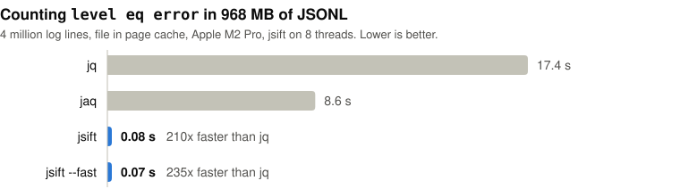

<div align="center">

<h1>jsift</h1>

<p><b>Search gigabytes of JSONL at <code>grep</code> speed, with <code>jq</code>'s exact answers.</b><br>
A SIMD query engine for line-delimited JSON, for the command line and Python.</p>

<p>
<a href="https://pypi.org/project/jsift/"></a>
<a href="https://pypi.org/project/jsift/"></a>
<a href="https://github.com/aikoschurmann/jsift/releases/latest"></a>
<a href="LICENSE"></a>
</p>

<p>
<a href="#install">Install</a> ·
<a href="#quick-start">Quick start</a> ·
<a href="#python">Python</a> ·
<a href="#benchmarks">Benchmarks</a> ·
<a href="#how-it-works">How it works</a>
</p>


<sub>The same query on 2 million log lines (462 MB): <code>jq</code> takes 9.3 s (cut from the GIF), jsift 0.14 s, with the same count. Recorded on an Apple M2 Pro.</sub>

</div>

<br>

<picture>
  <source media="(prefers-color-scheme: dark)" srcset="assets/benchmark-dark.svg">
  
</picture>

## Why jsift

- **Fast.** A SIMD search over the raw bytes rules out every line that provably can't match, so most of the file is never parsed, and large inputs are scanned on all cores. Over 10 GB/s from a file, and 85–200x faster than `jaq` (20–65x on a single core).
- **Exact.** Lines that might match go through a validating JSON parser that decides exactly. Nested paths, escapes and numbers like `9e1` work as in `jq`.
- **A query language you already know.** Filter with `eq`, `gt`, `has`, `in`, `AND`/`OR`/`NOT` and parentheses, pull out fields with `SELECT`, and compute `count`/`sum`/`avg`/`min`/`max`, optionally `GROUP BY` a field.
- **Python, too.** `pip install jsift` runs the same engine in-process, with the GIL released.
- **Streams.** Works on `tail -f`, prints matches as they arrive, and exits like `grep`.
- **No dependencies.** One static binary, or one wheel per platform.

## Install

**Python** (macOS and Linux, Python 3.9+)

```bash
pip install jsift
```

**Command line**

```bash
# macOS (Apple Silicon)
curl -fL https://github.com/aikoschurmann/jsift/releases/latest/download/jsift-macos-arm64 -o jsift && chmod +x jsift && sudo mv jsift /usr/local/bin/

# Linux (x86_64)
curl -fL https://github.com/aikoschurmann/jsift/releases/latest/download/jsift-linux-amd64 -o jsift && chmod +x jsift && sudo mv jsift /usr/local/bin/
```

<details>
<summary><b>Build from source</b></summary>

<br>

Requires [Zig](https://ziglang.org/download/) 0.16.0.

```bash
git clone https://github.com/aikoschurmann/jsift.git
cd jsift
zig build -Doptimize=ReleaseFast              # add -Dcpu=native for your CPU's widest SIMD
zig build test                                # run the test suite
```

The binary ends up at `./zig-out/bin/jsift`. To build and install the Python package from the checkout instead, run `pip install .` (it calls `zig build lib`), and `pytest python/tests` to test it.

The Linux binary targets baseline x86_64 so that it runs on any 64-bit CPU. That means 16-byte SSE2 vectors and no byte shuffle, which leaves out the [Teddy](#4-many-key-ors-teddy) path for many-key `OR`s. For full speed, build from source with `-Dcpu=native`.

</details>

## Quick start

```bash
# Filter: print matching lines
jsift --file app.jsonl level eq error AND status gte 500

# Extract fields and aggregate, per service
jsift --file app.jsonl SELECT service,count:bytes,avg:latency_ms WHERE status eq 200 GROUP BY service

# Follow a live log
tail -f app.jsonl | jsift level eq error
```

```python
import jsift

jsift.search("level eq error AND status gte 500", file="app.jsonl")  # -> list of dicts
jsift.count("level eq error", file="app.jsonl")                      # -> 333202
jsift.select("service,avg:latency_ms WHERE status eq 200", file="app.jsonl")
```

See [Usage](#usage) for the full query language and [Python](#python) for the API.

---

## Benchmarks

All numbers are the best of 5 runs (1 for jq/jaq), with the file in the OS page cache, on an Apple M2 Pro (6 performance and 4 efficiency cores, 16 GB). jsift is 3.1.0, built with `ReleaseFast`, on its default 8 threads unless marked `-j 1`. The ripgrep 15.1.0, jaq 2.3.0 and jq 1.7.1 numbers are from an earlier run on the same machine; they don't depend on jsift. Every tool returned the same matches. The commands are listed under [Reproducing the benchmarks](#reproducing-the-benchmarks).

### Synthetic logs: 968 MB, 4 million lines

Each line is a flat-ish log record of about 240 bytes with a nested `user` object and an array (see the generator below).

| Query | jsift | jsift `-j 1` | jsift `--fast` | jsift (pipe) | ripgrep | jaq |
|-------|------:|------:|------:|------:|--------:|----:|
| Key match: `level eq error` | 0.08 s · 11.7 GB/s | 0.25 s · 4.0 GB/s | **0.07 s** · 13.1 GB/s | 0.30 s · 3.2 GB/s | 0.14 s · 6.9 GB/s | 8.6 s · 0.11 GB/s |
| Numeric: `status gte 500` | 0.09 s · 10.9 GB/s | 0.40 s · 2.4 GB/s | **0.08 s** · 11.8 GB/s | 0.35 s · 2.8 GB/s | 0.18 s · 5.5 GB/s | 8.8 s · 0.11 GB/s |
| Substring: `msg has beef` | 0.09 s · 11.0 GB/s | 0.39 s · 2.5 GB/s | **0.09 s** · 11.4 GB/s | 0.34 s · 2.9 GB/s | 0.58 s · 1.7 GB/s | 8.2 s · 0.12 GB/s |
| AND/OR: `level eq error AND status eq 500 OR service eq auth AND status eq 404` | 0.09 s · 11.1 GB/s | 0.31 s · 3.2 GB/s | **0.08 s** · 11.7 GB/s | 0.32 s · 3.0 GB/s | 1.48 s · 0.65 GB/s | 10.2 s · 0.09 GB/s |
| TSV extraction: `SELECT service,status,bytes WHERE level eq warn` | 0.09 s · 10.9 GB/s | 0.27 s · 3.5 GB/s | **0.08 s** · 11.8 GB/s | 0.32 s · 3.0 GB/s | — | 18.0 s · 0.05 GB/s |
| JSON output: `--format json SELECT ts,user,latency_ms WHERE status eq 503` | 0.09 s · 11.0 GB/s | 0.38 s · 2.6 GB/s | **0.09 s** · 11.1 GB/s | 0.35 s · 2.8 GB/s | — | 8.7 s · 0.11 GB/s |
| Aggregates: `SELECT count:bytes,sum:bytes,avg:latency_ms WHERE status eq 200` | 0.13 s · 7.4 GB/s | 0.60 s · 1.6 GB/s | **0.09 s** · 10.8 GB/s | 0.37 s · 2.6 GB/s | — | 11.1 s · 0.09 GB/s |
| No match (full scan): `nosuchkey exists` | 0.08 s · 12.6 GB/s | 0.11 s · 8.9 GB/s | **0.08 s** · 12.9 GB/s | 0.27 s · 3.6 GB/s | 0.11 s · 8.6 GB/s | — |

jq 1.7.1 took 17.4 s (0.06 GB/s) on the key match, about twice as long as jaq, so it was only run once.

How to read this:
- **Exact mode pays for the lines it parses.** Lines that can't match cost the same as in `--fast` (`nosuchkey exists`). Every line that might match is validated and evaluated by the parser, at roughly 1.3 GB/s per thread. So on one thread, the more lines match, the bigger the gap: `level eq error` matches a sixth of the lines, `status eq 200` over a third. With 8 threads most queries reach the same ceiling as `--fast`, about 12 GB/s: the speed at which a single reader thread copies the file out of the page cache.
- **Pipe numbers are capped by the pipe.** Just `cat logs.jsonl | wc -c` takes 0.22 s (4.5 GB/s) here, and jsift's pipe times sit close to that ceiling. `--fast` through a pipe takes 0.27–0.33 s for every query above. When you can, pass the file.
- **ripgrep compares raw text**, so its patterns are approximations. The AND/OR regex (`"level":"error".*"status":500|…`) only works because the keys always appear in the same order, and ripgrep can't parse numbers (`status gte 500` became `"status":5[0-9][0-9]`). jsift's queries understand JSON values and don't depend on key order.
- ripgrep can't extract fields or aggregate, hence the dashes.

### Threads

Large inputs are scanned on several threads (see [Parallel scan](#5-parallel-scan)). The same queries on jsift 3.0.0, which scanned on one thread, and 3.1.0; best of 3, on the 968 MB file. The output is byte-for-byte the same in every column.

| Query | 3.0.0 | 3.1.0, `-j 1` | 3.1.0 | 3.0.0, pipe | 3.1.0, pipe |
|-------|------:|------:|------:|------:|------:|
| `-c level eq error` | 0.24 s | 0.24 s | **0.09 s** (2.7x) | 0.30 s | 0.30 s |
| `-c NOT level eq info` (parses every line) | 0.75 s | 0.74 s | **0.15 s** (5.1x) | 0.81 s | **0.37 s** (2.2x) |
| `-c status gte 500` | 0.40 s | 0.40 s | **0.09 s** (4.5x) | 0.48 s | **0.34 s** (1.4x) |
| `SELECT count:bytes,sum:bytes,avg:latency_ms WHERE status eq 200` | 0.60 s | 0.59 s | **0.13 s** (4.6x) | 0.66 s | **0.36 s** (1.8x) |
| `SELECT service,count:bytes,avg:latency_ms GROUP BY service` | 1.02 s | 1.03 s | **0.19 s** (5.4x) | 1.07 s | **0.37 s** (2.9x) |
| `level eq error > out.txt` (writes 162 MB) | 0.28 s | 0.28 s | **0.13 s** (2.1x) | 0.37 s | **0.32 s** (1.2x) |

Parse-bound queries scale linearly up to the 6 performance cores: `NOT level eq info` takes 0.74 s on 1 thread, 0.39 s on 2, 0.20 s on 4, 0.15 s on 6 and 0.14 s on 8. Cheap queries stop at the reader's copy speed sooner. Through a pipe, queries that one thread keeps up with gain nothing and stay on one thread. For the very cheapest, the median over 15 runs was 1–3% slower than 3.0.0: 0.272 s vs 0.269 s for `--fast -c level eq error`, and 0.286 s vs 0.277 s for `-c nosuchkey exists`. That is within a pipe's run-to-run noise, but it showed up consistently.

<details>
<summary><b>Real-world data: GitHub Archive, 3.1 GB</b></summary>

<br>

These were measured with jsift 1.0.0, on one thread, so they correspond to `--fast -j 1`. In exact mode, keys inside nested objects need their path: `login eq torvalds` becomes `actor.login eq torvalds`.

Three hours of [GH Archive](https://www.gharchive.org/) events: 791,615 deeply nested lines, median 945 bytes. For reference, `rg -cF '"type":"MemberEvent"'` takes 0.33 s on this file.

| Query | jsift |
|-------|----:|
| `type eq MemberEvent` | 0.31 s |
| `type eq ForkEvent OR type eq WatchEvent` | 0.30 s |
| `type eq ForkEvent OR action eq reopened` | 0.30 s |
| `login eq torvalds OR language eq Zig OR type eq GollumEvent` | 0.39 s |
| 8-way OR of different keys (`login`, `language`, `type`, `ref_type`, `pusher_type`, `action`, `state`, `license`) | 0.50 s |
| `type eq PullRequestEvent AND action eq closed OR type eq IssuesEvent AND action eq opened` | 0.30 s |
| `type eq PushEvent AND size gte 10` | 0.28 s |
| `NOT type eq PushEvent` | 0.30 s |
| `title has segfault` | 0.30 s |
| `SELECT login,name WHERE type eq WatchEvent` | 0.32 s |
| `SELECT count:size,sum:size,avg:size WHERE type eq PushEvent` | 0.30 s |

Most queries run at about 10 GB/s, on par with ripgrep's plain fixed-string count. An `OR` over many different keys costs little extra: 8 keys take 0.50 s, where testing each key separately would take over a second (see [Many-key ORs](#4-many-key-ors-teddy)).

</details>

---

## Usage

```text
jsift [options] [SELECT <fields> [WHERE]] <condition> [AND|OR <condition> ...] [GROUP BY <keys>] [<file>...]
```

jsift reads the files named after the query or with `--file`, in order, as one input: `--limit`, `--count` and aggregates span all of them. Without files it reads standard input.

```bash
jsift level eq error app.jsonl
jsift -c level eq error logs/*.jsonl
jsift SELECT service,count:id GROUP BY service jan.jsonl feb.jsonl
```

Files are the terms left over once the query is complete, so `SELECT` fields and `GROUP BY` keys must be joined by commas (`SELECT name,age` or `SELECT name, age`): in `SELECT name age file.jsonl`, `age` would be a file. A missing file is reported by name, with exit code 2, after the files before it were searched.

### Options

| Option | Meaning |
|--------|---------|
| `--file <path>` | JSONL file to read; repeatable. Files can also follow the query (default: stdin) |
| `--format tsv\|csv\|json` | Output format for `SELECT` (default: `tsv`) |
| `--count`, `-c` | Print only the number of matching lines |
| `--header` | Print a header row of field names (TSV/CSV) |
| `--limit <n>` | Stop after `n` matches |
| `--threads <n>`, `-j <n>` | Scan on `n` threads (default: one per CPU, up to 8). `-j 1` scans on one thread, and so do files of 2 MB or less. The output is the same either way |
| `--invert`, `-v` | Select the lines that don't match, like `grep -v`: the same as `NOT ( … )` around the whole condition. Lines that aren't valid JSON are still skipped |
| `--line-number`, `-n` | Prefix each match with its line number in its file (`12:{...}`). With `SELECT` it is a first column named `line`, or a `"line"` member in JSON. Ignored by `--count` and aggregates |
| `--fast` | Match on the raw bytes only, without the exact parse: faster, but approximate (see [Limitations](#limitations--trade-offs)) |
| `--help`, `-h` | Show help |
| `--version`, `-V` | Show the version |
| `--` | Treat all following arguments as query terms (for keys starting with `--`) |

### Conditions

A condition is `<key> <op> <value>`, or `<key> exists`.

| Operator | Matches when the key's value… |
|----------|-------------------------------|
| `eq` / `neq` | equals / doesn't equal the value (numbers compare by value: `eq 90` matches `90.0` and `9e1`) |
| `gt`, `gte`, `lt`, `lte` | compares numerically (the value must be a number) |
| `has` | contains the value as a substring (strings, and the text of numbers and literals; never objects or arrays) |
| `in` | equals one of a comma-separated list: `level in error,warn` (write `\,` for a comma inside a value, `\\` for a backslash) |
| `exists` | the key is present, whatever its value |

Keys name members of the top-level object. Use dots to reach into nested objects, and `\.` for a dot that is part of a key:

```bash
echo '{"id": 5, "user": {"id": 10}, "a.b": 1}' | jsift user.id eq 10    # matches
echo '{"id": 5, "user": {"id": 10}, "a.b": 1}' | jsift id eq 10         # doesn't
echo '{"id": 5, "user": {"id": 10}, "a.b": 1}' | jsift 'a\.b' exists     # matches
```

Keys may share a name with a keyword: `SELECT` and `NOT` count as keywords only when the next token isn't an operator, so `jsift select eq 1` and `jsift not exists` test the keys `select` and `not`. A `SELECT` field named `where` needs a trailing comma (`SELECT where,`), since a lone `WHERE` ends the field list.

When a key appears twice in the same object, the last one counts, as in `jq`. Lines that aren't valid JSON never match, not even `NOT` conditions.

Prefix a condition with `NOT` to negate it. `AND` binds tighter than `OR`, and parentheses group:

```bash
# A AND B OR C AND D  ==  (A AND B) OR (C AND D)
jsift --file demo.jsonl age eq 30 AND balance lt 0 OR tier eq 1 AND active eq true

# Parentheses can stand alone or touch a key or value. Quote a standalone one for the shell.
jsift --file demo.jsonl '(tier' eq 1 OR tier eq '5)' AND active eq b:true
jsift --file demo.jsonl NOT '(' age eq 30 OR tier eq 5 ')'
```

A `)` at the end of a value is only split off while a parenthesis is open, so `name eq (none)` still compares with `(none)`. `NOT` also applies to a parenthesised group. jsift multiplies the parentheses out into OR'ed groups of AND'ed conditions, and refuses a query that would expand to more than 1024 groups.

**`neq` vs `NOT … eq`:** every operator, `neq` included, requires the key to be present. `NOT` simply inverts the result, so `NOT a eq 1` also matches lines that have no `a` at all:

```bash
printf '{"a":1}\n{"a":2}\n{"b":1}\n' | jsift a neq 1       # {"a":2}
printf '{"a":1}\n{"a":2}\n{"b":1}\n' | jsift NOT a eq 1    # {"a":2} and {"b":1}
```

### Example dataset

The examples below use this `demo.jsonl` (it's in the repo):

```json
{"name": "Alice", "age": 25, "balance": 100.50, "active": true, "tier": 1}
{"name": "Bob", "age": 30, "balance": -50.25, "active": false, "tier": 2}
{"name": "Charlie", "age": 30, "balance": 0.0, "active": true, "tier": 3}
{"name": "Dave", "age": 45, "balance": 5000.00, "active": true, "tier": 4}
{"name": "Eve", "age": "45", "balance": "99.99", "active": "true", "tier": 5}
```

### Filtering

Without `SELECT`, matching lines are printed as they are.

```bash
jsift --file demo.jsonl age eq 30
# {"name": "Bob", "age": 30, "balance": -50.25, "active": false, "tier": 2}
# {"name": "Charlie", "age": 30, "balance": 0.0, "active": true, "tier": 3}

jsift --file demo.jsonl age eq 30 AND tier gt 2
# {"name": "Charlie", "age": 30, "balance": 0.0, "active": true, "tier": 3}

jsift --file demo.jsonl tier eq 1 OR tier eq 5
# {"name": "Alice", "age": 25, "balance": 100.50, "active": true, "tier": 1}
# {"name": "Eve", "age": "45", "balance": "99.99", "active": "true", "tier": 5}

jsift --file demo.jsonl NOT age eq 30
# {"name": "Alice", ...}
# {"name": "Dave", ...}
# {"name": "Eve", ...}

jsift --file demo.jsonl balance gt 100
# {"name": "Alice", ...}
# {"name": "Dave", ...}

jsift --file demo.jsonl name has li
# {"name": "Alice", ...}
# {"name": "Charlie", ...}

jsift --file demo.jsonl tier in 1,3,5
# {"name": "Alice", ...}
# {"name": "Charlie", ...}
# {"name": "Eve", ...}

jsift --file demo.jsonl balance exists          # every line
jsift --file demo.jsonl --count active eq true  # 4 (Eve's "true" string counts, see Types)
jsift --file demo.jsonl --limit 2 active eq true
```

### Types

By default a value matches both its JSON type and its string form: `active eq true` matches `true` and `"true"`, and `balance lt 100` matches `-50.25` and `"99.99"`. Numbers inside strings are compared as numbers. To force a type, prefix the value:

| Prefix | Matches |
|--------|---------|
| `s:` | strings only |
| `n:` | numbers, booleans and `null` only |
| `b:` | same as `n:`, reads better for booleans |

```bash
jsift --file demo.jsonl SELECT name WHERE active eq true      # Alice Charlie Dave Eve
jsift --file demo.jsonl SELECT name WHERE active eq b:true    # Alice Charlie Dave
jsift --file demo.jsonl SELECT name,tier WHERE balance lt s:100
# Eve     5
jsift --file demo.jsonl SELECT name,tier WHERE balance lt n:100
# Bob     2
# Charlie 3
```

`has` follows the prefixes too: `has s:42` only searches string values, `has n:42` only numbers and other literals.

Strings are compared after decoding their escapes, so `msg eq 'say "hi"'` matches `"msg": "say \"hi\""` and `name eq café` matches `"name": "caf\u00e9"`. Keys are decoded the same way.

### Field extraction (SELECT)

`SELECT` prints the listed fields of each matching line. `WHERE` is optional: a bare `SELECT` reads every line.

```bash
jsift --file demo.jsonl SELECT name,tier WHERE balance lt 100
# Bob     2
# Charlie 3
# Eve     5

jsift --file demo.jsonl --limit 3 SELECT name,age
# Alice   25
# Bob     30
# Charlie 30

jsift --file demo.jsonl --header SELECT name,tier WHERE balance lt 100
# name    tier
# Bob     2
# ...
```

Output formats:

```bash
jsift --file demo.jsonl --format json SELECT name,age WHERE tier eq 5
# {"name": "Eve", "age": "45"}

jsift --file demo.jsonl --format csv --header SELECT name,balance WHERE tier lte 2
# name,balance
# "Alice","100.50"
# "Bob","-50.25"
```

- **TSV** (default) prints string contents as they appear in the JSON, so `\t`, `\n` and `\"` stay escaped and the columns stay intact.
- **CSV** quotes every field, decodes JSON escapes (`\n`, `é`, surrogate pairs) and doubles embedded quotes.
- **JSON** prints one object per line, keeping strings quoted and escaped. `--header` is ignored, since every object already names its fields.

Missing fields print as empty in TSV/CSV and as `null` in JSON. Objects and arrays are extracted whole (`{"b": [1, 2]}`).

### Aggregations

| Function | Result |
|----------|--------|
| `count:field` | number of values that are present and not `null` |
| `sum:field` | sum of numeric values |
| `min:field` / `max:field` | smallest / largest numeric value |
| `avg:field` | mean of numeric values |

```bash
jsift --file demo.jsonl SELECT count:name WHERE tier gte 2
# 4

jsift --file demo.jsonl SELECT min:age,max:balance WHERE active eq true
# 25      5000

jsift --file demo.jsonl SELECT count:name,sum:balance,avg:age,min:age,max:tier WHERE active eq true
# 4       5200.49 36.25   25      5

jsift --file demo.jsonl --format json SELECT count:name,sum:balance WHERE tier gte 2
# {"count:name": 4, "sum:balance": 5049.74}

cat demo.jsonl | jsift SELECT sum:balance
# 5150.24
```

- All aggregates are computed in one pass, each field independently.
- Results print in their shortest form. Sums, minimums and maximums of integers are exact, at any size. Other results are rounded to 15 significant digits, so `0.1 + 0.2` sums to `0.3`.
- Numbers stored as strings (`"99.99"`) are included. Values that aren't JSON numbers (`"abc"`, `"nan"`, `"inf"`) are skipped.
- If `SELECT` contains **any** aggregate, jsift prints one summary row at the end. Plain fields in that row come out empty (TSV/CSV) or `null` (JSON): `SELECT name,count:name` prints an empty column, then `4`.

### Grouping (GROUP BY)

`GROUP BY` goes at the end of the query and prints one aggregate row per distinct value of its keys:

```bash
jsift --file logs.jsonl SELECT service,count:bytes,avg:latency_ms WHERE level eq error GROUP BY service
# shipping  66643   451.002028870249
# auth      66903   450.276507645397
# ...

jsift --file demo.jsonl --format json SELECT active,count:name GROUP BY active
# {"active": true, "count:name": 3}
# {"active": false, "count:name": 1}
# {"active": "true", "count:name": 1}      (Eve's string "true" is a group of its own)

jsift --file app.jsonl SELECT service,level,count:id GROUP BY service,level
```

- Every plain field in `SELECT` must be one of the group keys, since anything else has no single value per group. Group keys don't have to be selected.
- Groups are printed in the order they're first seen. Pipe through `sort` to order them.
- Values group exactly: strings are compared after decoding their escapes, and a string never groups with a number (`"1"` and `1` are separate groups). A missing key is a group of its own, printed empty (TSV/CSV) or `null` (JSON).
- `SELECT level GROUP BY level`, without aggregates, lists the distinct values.

### Pipelines and scripting

```bash
# Live monitoring: matches print as soon as their lines arrive
tail -f app.jsonl | jsift level eq error

# Stop at the first match, even on a stream that never ends
tail -f app.jsonl | jsift --limit 1 level eq error

# Line numbers, like grep -n (they restart in every file)
jsift -n level eq error app.jsonl

# Chain with other tools
jsift --file demo.jsonl SELECT name WHERE tier gte 3 | sort

# Query terms that start with "--" go after "--"
jsift --file logs.jsonl -- --weird-key exists

# Exit codes work like grep's
if jsift --file logs.jsonl --count level eq error > /dev/null; then echo "errors found"; fi
```

| Exit code | Meaning |
|-----------|---------|
| `0` | At least one line matched (also when the reader closes early, e.g. <code>&#124; head</code>) |
| `1` | No lines matched |
| `2` | Error: bad arguments, unreadable input, a non-numeric value for `gt`/`lt`/…, or a failed write |

---

## Python

The Python package bundles jsift as a native library and calls it directly. It doesn't start a subprocess or need a binary on your `PATH`. Queries use the same language as the CLI. The search runs with the GIL released, so other Python threads keep going, and several searches can run in parallel. Large inputs are scanned on several threads, as on the command line (`threads=1` for one).

```python
import jsift

# Matching lines, parsed into dicts
jsift.search("level eq error AND status gte 500", file="app.jsonl")

# Count matches without building any objects
jsift.count("level eq error", file="app.jsonl")

# Pull out fields (SELECT is optional here) or aggregate
jsift.select("service,latency_ms WHERE status eq 200", file="app.jsonl")
# -> [{"service": "storage", "latency_ms": 229.562}, ...]
jsift.search("SELECT count:bytes,avg:latency_ms WHERE service eq auth", file="app.jsonl")
# -> [{"count:bytes": 400825, "avg:latency_ms": 449.8548}]

# JSONL already in memory: bytes or str
jsift.search("user.id in 1,2,3", data=response.content)

# Matching lines as raw bytes, without parsing them (fastest)
jsift.search_lines("level eq error", file="app.jsonl", limit=100)

# Byte-level matching only: faster, approximate (same as --fast)
jsift.count("level eq error", file="app.jsonl", fast=True)

# Exactly the CLI's output, in any format
jsift.run("SELECT name,age", file="people.jsonl", format="csv", header=True).output
```

| Function | Returns |
|---|---|
| `search(query, *, file=, data=, limit=, fast=, invert=, threads=)` | Matching lines (or SELECT rows) parsed as JSON: `list[dict]` |
| `select(...)` | Same as `search`, with `SELECT` added to the front if missing |
| `search_lines(...)` | Matching lines as `list[bytes]`, not parsed |
| `count(query="", *, file=, data=, fast=, invert=, threads=)` | Number of matching lines: `int` |
| `run(query, *, file=, data=, limit=, fast=, invert=, format=, count_only=, header=, threads=)` | `Result(output: bytes, matched: int)`: the CLI's exact output |

A query is a string, split the way a shell splits a command line, or a list of tokens such as `["level", "eq", "error"]`. Pass exactly one of `file=` (a path) or `data=`. `threads=` is the number of threads to scan on (default: one per CPU, up to 8); the result is the same for any. An invalid query, or a file that can't be read, raises `jsift.JsiftError`.

Wheels are available for macOS (arm64, x86_64) and Linux (x86_64 and aarch64; glibc and musl/Alpine). One wheel per platform covers every Python version from 3.9 up. On other platforms pip builds from source, which needs [Zig](https://ziglang.org/download/) 0.16.0.

---

## How it works

Tools like `jq` parse every line into a tree before they look at it. That is exact, but it caps them at roughly 0.1 GB/s. jsift first treats the input as bytes and searches it with SIMD for lines that *could* match. Only those lines are parsed (sections 6 and 7), and the parse decides. The byte search is built so that it never drops a line the parser would accept: it may let through lines that don't match, but never lose one that does.

### 1. Query compilation

Before scanning, the query is compiled into a plan. Key paths are split and gathered into a tree for the parser, keys and values are JSON-escaped and quoted for the byte search, numbers are parsed once, type prefixes are resolved, and the SIMD comparison vectors are built. Nothing in the hot loop depends on the query text.

### 2. Anchored block search

Input is processed in blocks (8 MB on one thread, 512 KB chunks on several), not line by line. Every matching line must pass at least one non-negated condition of some `OR` group, so jsift picks one such **anchor** per group and searches the whole block for anchors. Line boundaries are only looked up once an anchor passes. A line without an anchor costs a few vector compares and is never split out.

For a string `eq`, the anchor is the quoted **value** rather than the key: `"GollumEvent"` is far rarer than `"type"`, which appears in nearly every event. A hit counts only when `"type":` directly precedes it.

### 3. SIMD key matching

Keys are found with vector compares sized to the target (NEON, SSE, AVX2, AVX-512). A position is a candidate only when the opening quote, the key's first and last byte, and the closing quote all line up. A full compare runs only on the rare candidates, followed by checks that the quote isn't escaped and that a `:` follows. Requiring the colon means a *value* that happens to equal a key name is never mistaken for the key.

All anchors are searched for in a single pass, so an `OR` of several keys still reads each byte once.

### 4. Many-key ORs (Teddy)

Testing each key separately gets slower with every key you add. From four different anchors on, jsift switches to [Teddy](https://github.com/intel/hyperscan), the multi-literal matcher from Intel's Hyperscan. Keys are spread over 8 buckets. For each of the three bytes after a quote, two 16-entry nibble tables, looked up with a single byte-shuffle instruction (`tbl` on ARM, `pshufb` on x86), say which buckets allow that byte there. ANDing the lookups leaves the buckets whose keys may start at each position. The cost per chunk is fixed, however many keys there are, and only keys from the matching buckets are compared in full.

On the GH Archive file this takes a 12-key `OR` from 1.92 s to 0.52 s.

### 5. Parallel scan

A reader thread cuts the input into chunks that end at a newline: 512 KB for files, and for pipes 128 KB or whatever has arrived when the pipe runs dry, so slow streams like `tail -f` print matches right away. The chunks go to a ring of two slots per thread. Worker threads, each with its own parser and scratch space, scan chunks into output buffers of their own, and the main thread writes the buffers out in input order, so the output is the same as on one thread. Lines longer than a chunk grow its buffer.

- **The main thread scans too.** It takes the chunk at the head of the line itself when no worker has, and workers are only woken once two chunks wait past it. Input that one thread keeps up with, as from most pipes, then goes through a single handoff per chunk and the workers sleep. Read buffers are reused most recently freed first, so that data is still in the cache when it is scanned.
- **Aggregates are merged in order.** Every chunk counts, sums and groups into its own state, and the main thread folds them in chunk by chunk. Counts and integer sums are exact. Float sums keep both chunks' compensation, so they agree with the single-threaded sum to far more digits than the 15 printed; only values that cancel almost exactly could change the last printed digit. Min and max keep the first of equal values, and groups keep their first-seen order and spelling.
- **`--limit` and `-n`.** A worker doesn't know how many matches or lines came before its chunk. The reader counts each chunk's newlines (only with `-n`) and gives it its starting line. The chunk that reaches the limit is scanned again by the main thread, which knows the count, so the output stops at exactly the right match. Then the workers stop. A reader waiting on a pipe that never ends is left to finish on its own, so `tail -f app.jsonl | jsift --limit 1 …` still exits.
- **Small inputs stay on one thread.** Files of 2 MB or less are scanned as with `-j 1`, and on a pipe, workers only start once chunks pile up, so `echo '{"a":1}' | jsift a exists` starts none. Read and write errors are reported as on one thread, after the output of everything before them.

With `-j 1`, a reader thread fills one 8 MB buffer (128 KB for pipes) while the main thread scans the other, as before.

### 6. Ruling lines out without losing matches

The byte search finds a key wherever it appears, nested or not, and the value at a key's path is always one of those occurrences. A condition is tested on each occurrence with exactly the code the parser later uses on the value at the path. So if no occurrence passes, the parser can't find a passing value either, and the line is dropped. Two things would break that argument, and jsift handles both:

- **Escapes.** The search compares escaped text, as jsift writes it: `"`, `\` and control characters escaped, everything else as is. JSON allows two other spellings, `\uXXXX` for any character and `\/` for `/`, and those would hide a key or value from the search. So the search also stops at every `\u` and `\/`, folded into the same SIMD pass. If the escape stands for a character that occurs in one of the searched keys or values, the line goes to the parser. Other escapes, such as the `\u003c` that Go writes for `<`, cost one check and nothing more.
- **`NOT`.** Bytes can show that a key is missing, but not that the value at its path fails, since a nested copy of the key may be the one that fails. The search therefore ignores negated conditions and leaves them to the parser.

`zig build test` fuzzes this: it runs random queries over random lines full of escapes, nesting, repeated keys and odd whitespace, with and without the byte search, and requires the same output.

### 7. The exact layer

Lines that may match are parsed by a validating parser (RFC 8259, including UTF-8) that works in two stages, like [simdjson](https://github.com/simdjson/simdjson):

- **Stage 1** classifies 64 bytes at a time with SIMD compares and turns them into bitmasks: quotes, backslashes, `{}[]:,` and whitespace. Escaped quotes are found from runs of backslashes, and a prefix XOR over the remaining quotes marks everything inside strings. What's left is one bit per structural character: `{}[]:,` outside strings, each quote, and the first byte of each number or literal. The same pass rejects control characters in strings and malformed escapes, and lines with non-ASCII bytes get a SIMD UTF-8 check (the lookup algorithm from simdjson).
- **Stage 2** checks the grammar by visiting only the marked positions, so the bytes inside strings are never looked at again. It takes the positions straight from the bitmask, and stage 1 classifies the next 64 bytes when the mask runs out, so nothing is stored per line.

Stage 2 only descends into the objects on the query's key paths. Everything else is checked and skipped by a non-recursive loop, so deep nesting can't overflow the stack. It records where the value of each path starts and ends in the line, and the conditions and `SELECT` read the values from there. Strings are decoded only when they contain escapes.

On the synthetic logs this parses 1.7x as fast as the single-pass parser it replaced, and 1.2–1.4x as fast on short lines and on nested, escape-heavy lines.

### 8. No per-line allocation

Apart from the I/O buffers (two per thread), the compiled plan, each thread's output buffer and a reusable buffer for decoded strings, the scan allocates nothing. Values are extracted in place, output goes through one buffered writer, and aggregates are plain counters.

---

## Limitations & trade-offs

### 1. Exact mode parses every line that might match

Lines the byte search rules out cost almost nothing, but the rest are parsed at roughly 1.3 GB/s per thread. On one thread, queries that match many lines, and `NOT`-only queries, which can't be ruled out from bytes at all, run several times slower than with `--fast`. Several threads close most of that gap on files (see the benchmarks).

### 2. `--fast` is approximate

`--fast` skips the parser and decides on the bytes alone, like jsift 1.0:

- A key matches at any depth. For a path, only its last key is used. A condition passes if **any** occurrence of the key passes, and `SELECT` takes the **first** occurrence.
- Escapes aren't decoded: `"\u006cevel"` isn't the key `level`.
- Lines aren't validated.

```bash
echo '{"id": 5, "metadata": {"id": 10}}' | jsift --fast id eq 10    # matches
echo '{"id": 5, "metadata": {"id": 10}}' | jsift id eq 10           # doesn't
```

For flat logs without escapes, `--fast` gives the same answers.

### 3. One JSON document per line

Only JSONL/NDJSON is supported. Pretty-printed, multi-line JSON isn't. Input must be UTF-8, and lines that aren't valid JSON are skipped.

### 4. Lone surrogates

Strings are compared after decoding. An unpaired `\ud800`-style escape decodes to U+FFFD, as in `jq`, so it equals any other lone surrogate and a literal U+FFFD.

---

## Reproducing the benchmarks

<details>
<summary>Data generator and commands</summary>

<br>

Generate the synthetic file:

```python
# gen.py: python3 gen.py logs.jsonl 4000000
import random, json, sys
random.seed(1)
levels = ["debug", "info", "info", "info", "warn", "error"]
svcs = ["auth", "billing", "search", "shipping", "storage"]
with open(sys.argv[1], "w") as f:
    for i in range(int(sys.argv[2])):
        d = {"ts": 1700000000 + i, "level": random.choice(levels), "service": random.choice(svcs),
             "status": random.choice([200, 200, 200, 201, 301, 404, 500, 503]),
             "latency_ms": round(random.random() * 900, 3),
             "user": {"id": random.randint(1, 10**6), "name": "user%d" % random.randint(1, 99999)},
             "msg": "request handled for session %x with some padding text here" % random.getrandbits(64),
             "tags": ["a", "b", "c"], "bytes": random.randint(100, 100000)}
        f.write(json.dumps(d, separators=(",", ":")) + "\n")
```

The GH Archive file:

```bash
for h in 15 16 17; do curl -sLO https://data.gharchive.org/2024-03-12-$h.json.gz; done
gunzip -c 2024-03-12-*.json.gz > gha.jsonl
```

Commands per tool (key match shown; the other rows follow the same pattern):

```bash
jsift --file logs.jsonl -c level eq error
cat logs.jsonl | jsift -c level eq error
rg -c '"level":"error"' logs.jsonl
jaq -c 'select(.level=="error")' logs.jsonl | wc -l
```

Match queries are timed with `-c` on both jsift and ripgrep, because ripgrep stops after the first match when its output is `/dev/null`. Extraction and aggregation queries write their full output to a file. Add `-j 1` for the single-threaded numbers.

</details>

---

## Use cases

- **DevOps & SRE:** filter production logs for errors, slow requests or 5xx responses
- **Security:** hunt through audit and access logs
- **Data engineering:** pre-filter large datasets before loading them elsewhere
- **Analytics:** count, sum and average over gigabytes in a single pass
- **CLI workflows:** chain with `sort`, `uniq`, `awk` and friends
- **Live monitoring:** filter `tail -f` or `journalctl -f` output as it arrives

**Not suitable for:** validating JSON (invalid lines are skipped, not reported), indexing into arrays, pretty-printed JSON, or formats other than JSONL.

---

## Contributing

Contributions are welcome! Open an issue or a pull request on [GitHub](https://github.com/aikoschurmann/jsift).

---

<div align="center">
<sub>MIT licensed · If jsift saved you some time, a ⭐ helps others find it.</sub>
</div>
